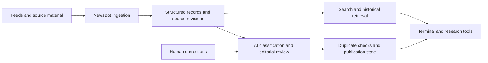

# Blockchain Daily: AI-Powered Market Intelligence

**Full-stack development · AI systems · Financial data · Cost optimization**

[Portfolio](../README.md) · [Explore the live Terminal](https://blockchaindaily.org)

## Overview

I co-founded Blockchain Daily and developed its market-intelligence software: a web-based Terminal supported by NewsBot, an AI-assisted ingestion, editorial review, and publishing backend. My work connects financial-domain knowledge with application engineering, data infrastructure, and the operating needs of a subscription product.

The core challenge is turning fragmented, repetitive financial information into useful research material at a sustainable operating cost. A headline summary alone is insufficient: the system must retain sources, recognize new developments, preserve processing state, and make accumulated information searchable.

## Architecture

### Terminal: the user-facing product

The Terminal provides a workspace for market news, charts, asset discovery, research, and AI-assisted interaction. Its application stack includes:

- **TypeScript and React/Vinext** for the interface
- **Cloudflare D1 and Drizzle** for application data and database access
- **Supabase authentication** for user accounts
- **Stripe** for subscription and payment integration
- **Market-data and exchange integrations** for financial tools

This work encompasses interface development, access-controlled features, database-backed state, external-service integration, and deployment configuration. It connects the research experience to the practical account and subscription workflows behind a commercial application.

### NewsBot: ingestion, intelligence, and publishing

The Python backend collects source material through feeds and browser-based collection where needed. It applies classification, summarization, editorial checks, duplicate detection, and publication-state handling. SQLite storage and full-text indexing support historical retrieval; source revisions and timestamps preserve how records change over time.

This is a logical architecture: individual workflows use the stages appropriate to their task.

## AI Systems Engineering

I designed the AI workflows around distinct, inspectable responsibilities. Classification, summarization, editorial review, retrieval, and publication can be examined and improved separately, rather than being hidden inside one large model prompt.

**Source-grounded processing.** Captured material and retrieval tools give model outputs a concrete information base. Source revisions, temporal queries, and full-text search make it possible to recover the information available when a decision was made.

**Human feedback and traceability.** An append-only decision ledger links model decisions to source revisions, prompt versions, and human corrections. This provides context for investigating mistakes, comparing behavior, and refining individual stages.

**Model-to-tool integration.** LLM tool workflows and MCP access connect assistants to news, market data, and application functions. The engineering work includes the interface between the model, retrieval layer, and downstream operations.

**Reusable research data.** Structured feedback and reproducible training-data exports support evaluation and future specialized model development. The implemented work is specialized AI application infrastructure and data preparation; proprietary model training is a separate step.

## Making Information More Valuable

The data architecture turns incoming material into a reusable research asset. A captured story can contribute to a historical query, source comparison, classification review, or later analytical dataset instead of being discarded after publication.

This requires preserving provenance and time context alongside the content. The resulting archive supports research applications, expert-review workflows, and domain-specific analytical tools. It also creates a practical path from an information business's existing knowledge to new software features.

## Cost-Conscious Design

**The system runs for approximately $3 per day in my reported operating setup**, following rigorous cost optimization. This owner-reported estimate depends on workload and included services; it should not be treated as an independently measured all-in benchmark.

My approach emphasizes:

- Matching model and tool choices to the complexity of each task
- Avoiding unnecessary repeated processing
- Reusing structured information through retrieval
- Detecting duplication before additional downstream work
- Keeping workflows observable enough to investigate both quality and cost
- Adding inference expense only when the resulting improvement justifies it

The aim is a useful, sustainable product: reducing expenditure while preserving the quality needed for its actual workflow.

## Reliability and Business Operations

External services can fail ambiguously. A publishing request may succeed even when its response is lost, while background workers can stop midway through processing. NewsBot includes worker leases, retries, dead-letter handling, and uncertain-post reconciliation to address those cases.

These mechanisms coordinate work, retain failures for investigation, and distinguish an uncertain publication outcome from a confirmed failure. Preserved processing state supports recovery and diagnosis. Alongside the Terminal's authentication, subscriptions, access controls, and database management, this demonstrates the operational engineering surrounding the visible product.

## Role and Evidence

My responsibilities span software implementation, market-intelligence requirements, editorial judgment, and product direction. Trading and financial-news experience inform which information matters, how timing affects interpretation, and how research requirements translate into software behavior. The Blockchain Daily brand reached a historical audience of **55,000+ followers**.

The live Terminal demonstrates the interface. This case study describes the broader implementation; private backend source and operational data are not distributed here. The audience figure is historical, and the cost figure describes my reported setup rather than current subscriber revenue or independently verified operating results.

## What This Showcases

- **Full-stack ownership:** interface, accounts, subscriptions, databases, and external integrations
- **AI systems engineering:** source-grounded workflows, tool access, feedback, and traceable decisions
- **Data engineering:** capture, revision tracking, temporal retrieval, and reusable datasets
- **Operational judgment:** recoverable asynchronous workflows and deliberate cost-quality tradeoffs
- **Domain translation:** turning financial research needs into usable software products
