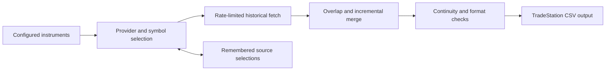

# Market-data engineering for TradeStation

**Python · CCXT · OHLCV data · Incremental ingestion · Validation · Platform integration**

[Portfolio](../README.md)

## Problem and contribution

Trading research needs usable price history, not just a successful API response. Exchanges expose different symbol conventions, pagination rules, availability windows, rate limits, and numerical formats. Desktop research platforms add their own import requirements.

I built a Python ingestion and normalization pipeline that prepares exchange price history for TradeStation, with incremental updates, provider fallback, configurable validation, and regression tests for pagination and output formatting. The underlying project remains private; this page describes its engineering approach without distributing source or datasets.

## Pipeline

## Design decisions

- **Incremental overlap:** Refetch overlapping history before merging rather than assuming the last stored bar is final and complete.
- **Provider fallback:** Try alternative providers where a requested instrument or history is unavailable; retain source-selection information to avoid repeatedly rediscovering the same choice.
- **Rate-limit awareness:** Treat exchange request limits as ingestion constraints rather than interpreting throttling as missing market history.
- **Completeness checks:** Examine historical coverage and pagination behavior, not just file existence.
- **Decimal-safe output:** Preserve price precision when formatting data for TradeStation imports.
- **Local operation:** Support a Python virtual environment and Windows scheduling workflow for repeatable updates.

## Data semantics matter

The crypto daily-data path can fill missing candles using the previous close for open, high, low, and close, with zero volume. These are synthetic continuity bars, not observed trades. They must be distinguished from real observations when evaluating volatility, volume, or trading results.

This is an important tradeoff: a continuous series may be easier to consume, but filling gaps changes the meaning of the data. Historical research needs to account for that transformation.

## Additional market coverage

The project also contains Yahoo, Naver, and KRX-oriented Korean-stock ingestion paths and tests. Their presence demonstrates integration work; current live coverage and reliability are not established here.

A related private EasyLanguage indicator computes trailing four-period reported EPS, with configurable fundamental-field fallback and missing-data diagnostics. Vendor fields can use different earnings definitions, so a fallback must not silently be treated as equivalent issuer-adjusted non-GAAP data.

## What this demonstrates

This work connects data engineering to the practical constraints of market analysis: external-service variability, numerical precision, data lineage, incremental recovery, and compatibility with an existing trading platform.
