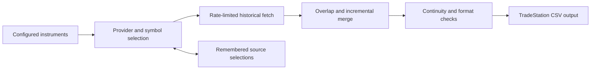

# Market Data Pipeline for TradeStation

**Python · CCXT · OHLCV data · Incremental ingestion · Validation · Platform integration**

[Portfolio](../README.md) · [Public source and setup](https://github.com/blockchaindailyai/market-data-pipeline) · [Tests](https://github.com/blockchaindailyai/market-data-pipeline/tree/main/tests)

## Problem and contribution

Trading research needs usable price history, not just a successful API response. Exchanges expose different symbol conventions, pagination rules, availability windows, rate limits, and numerical formats. Desktop research platforms add their own import requirements.

I built a Python ingestion and normalization pipeline that prepares daily exchange price history for TradeStation, with incremental updates, provider fallback, configurable consistency checks, and regression tests. The public source release includes optional Korean-stock adapters and Windows setup tools. It excludes generated datasets, logs, caches, local configuration, and compiled executables.

## Pipeline

## Design decisions

- **Incremental overlap:** Refetch seven days of recent history before merging when local data passes checks, rather than assuming the last stored bar is final.
- **Provider selection:** Compare available history and retain source choices locally to reduce repeated discovery work.
- **Bounded fetching:** Combine pagination, retries, duplicate-page detection, and exchange rate-limit handling.
- **Read-back verification:** Compare saved transformed values with fetched data to detect output inconsistencies.
- **Platform-compatible formatting:** Emit date and OHLCV columns with configurable decimal formatting, avoiding scientific notation.
- **Repeatable local operation:** Provide virtual-environment setup, example configuration, and Windows launchers, including an optional Task Scheduler entry point.

## Data semantics matter

Preparing data for another platform involves transformations that must remain visible to the researcher:

- **Synthetic continuity bars:** Missing crypto daily dates are filled with previous-close OHLC and zero volume. They are not separately flagged in the six-column CSV, so a continuous output does not prove complete observed history.
- **Price scaling:** Very small prices can be multiplied before formatting, and the multiplier is not stored in the CSV. Incremental updates can mix previously scaled rows with new raw rows. Preserve original data and validate scaling before quantitative use; this inherited limitation remains in the release.
- **Time and session conventions:** Crypto dates derive from UTC. Korean-stock dates are mapped from the Seoul opening time to New York calendar dates. Current-session quotes may be partial, and stock paths retain sparse trading dates.

These decisions affect volatility, volume, returns, and backtest interpretation. The implementation makes the import workflow inspectable while documenting where additional data-quality work is needed.

## Setup and validation

Use **Python 3.11+** with CCXT, pandas, and tzdata. The Windows setup script prefers Python 3.12; macOS/Linux can use a manually created virtual environment. Example configuration requests BTC/USDT and ETH/USDT daily history with stocks disabled and requires no API credentials. The scheduled launcher does not install a scheduled task automatically.

Release preparation passed **62 offline tests** and a clean Windows installation check. Tests cover pagination, synthetic bars, formatting, provider parsing and fallback, stock-date conversion, and Unicode output using mocked inputs with network connections disabled. The [repository README](https://github.com/blockchaindailyai/market-data-pipeline/blob/main/README.md) provides reproduction commands and operational constraints. These checks validate software behavior within their fixtures; live provider availability and complete historical coverage depend on the upstream services.

## Additional market coverage

Optional Korean-stock ingestion uses Naver and Yahoo adapters, with multiple sources for universe discovery. Configured watchlists and dynamic ranking are supported, but point-in-time universe completeness and corporate-action consistency require further validation.

A related private EasyLanguage indicator computes trailing four-period reported EPS, with configurable fundamental-field fallback and missing-data diagnostics. Vendor fields can use different earnings definitions, so a fallback must not silently be treated as equivalent issuer-adjusted non-GAAP data.

## What this demonstrates

This project connects data engineering to market analysis: external-service variability, explicit transformations, incremental updates, platform-compatible output, and testable failure handling. It also demonstrates turning an internal utility into a documented, inspectable source release without distributing its runtime data.

The public release grants no new license; licensing remains pending. Third-party data rights and provider access policies apply separately. The tool prepares data and does not place orders or connect to a TradeStation brokerage account.
