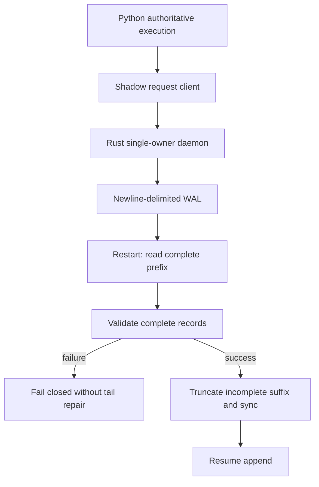

# Rust shadow execution: recovering an append-only log

[Portfolio](../README.md) · [Actual Rust excerpt and tests](../rust-shadow-sample/src/lib.rs) · [Quickstart](../rust-shadow-sample/README.md) · [Pinned provenance](../rust-shadow-sample/PROVENANCE.md)

The Rust work explores execution behavior alongside an authoritative Python engine. Python retains execution authority. A useful engineering boundary is restart safety: a process can stop after writing only part of its next log record. Recovery must distinguish that incomplete suffix from a complete record that fails validation.

## Architecture and scope



The public library isolates the read/validate/truncate boundary. The daemon, transport, trading models and replayed account state are outside the excerpt. The validator is a callback so this real file-repair code can be examined without publishing the rest of the system.

## The source-level decision

This boundary calculation comes directly from `executiond/src/wal.rs::load_recovery`:

```rust
let valid_len = if bytes.is_empty() || bytes.ends_with(b"\n") {
    bytes.len()
} else if let Some(last_newline) = bytes.iter().rposition(|byte| *byte == b'\n') {
    last_newline + 1
} else {
    0
};
bytes.truncate(valid_len);
```

After validating the retained records, the source's `WalStore::open` physically applies `file.set_len(valid_len)` and `file.sync_all()`. The ordering matters: silently dropping complete corrupt records could hide a loss of committed state; leaving partial bytes on disk could corrupt the next append.

The original daemon appends newline-terminated records, flushes the writer, and synchronizes the file before updating its successful append bookkeeping. That is the source's basis for treating an unterminated suffix as discardable. The extracted library tests the recovery side; it does not prove the end-to-end acknowledgement contract.

## Evidence and tradeoffs

Two upstream tests are adapted: torn-tail repair followed by append/reopen, and rejection of a complete corrupt record. Two additional tests check failure before mutation and edge cases. The sample has no third-party dependencies and uses synthetic fixtures. [Hosted CI verified all four tests and Clippy](https://github.com/blockchaindailyai/trevor-portfolio/actions/runs/39029700368) on Ubuntu 24.04.5 with Rust 1.99.0 at source commit `57e88de02ebc843ce43f953578fcdb9db14decae`. See the README for reproduction commands and validation limits.

Recovery currently reads the whole log into memory and assumes exclusive file ownership. The excerpt leaves JSON, digest-chain, schema and snapshot validation to its caller. It does not present the synthetic test validator as production validation.

This remains shadow-only research with Python authoritative. No production latency, profitability, live execution, custody or signing guarantee is claimed. The original proprietary designation is retained; public excerpt authorization is not a license change.

## Continuing integration work

The broader Python/Rust integration explores write-ahead-log serialization fidelity, conditional-controller behavior, and differential comparisons using synthetic inputs. The design keeps Python authoritative while exercising an isolated Rust path and comparing behavior across the boundary.

Full entry/exit parity and end-to-end integration remain ongoing. The public recovery excerpt above is unchanged and remains the inspectable code sample; broader integration experiments are separate from its four-test suite.
